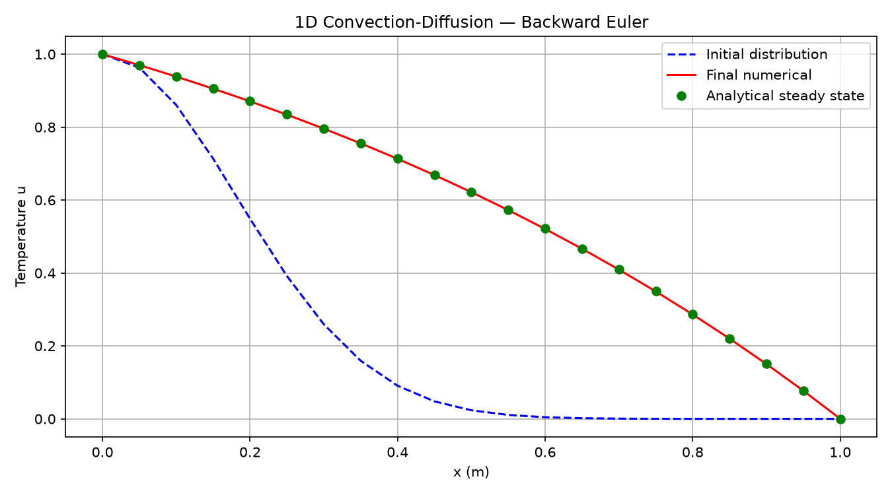

# Implicit Finite-Difference Solver for 1D Convection–Diffusion (Fortran)

A Fortran 90 solver for transient heat transport in a 1 m rod. It combines an implicit **backward Euler** time-stepping scheme with the **Thomas algorithm** for the tridiagonal system that arises at each step.

$$\frac{\partial u}{\partial t} + \nu \frac{\partial u}{\partial x} = \alpha \frac{\partial^2 u}{\partial x^2}, \qquad u(0,t)=A,\quad u(1,t)=B,\quad u(x,0)=e^{-15x^2}$$

<p align="center"></p>

## Method

* **Discretisation:** first-order backward difference in time and second-order central differences for both the convective and the diffusive term, evaluated at the new time level. The scheme is fully implicit and unconditionally stable.
* **Linear solver:** at each step the tridiagonal system *a<sub>i</sub>u<sub>i−1</sub> + b<sub>i</sub>u<sub>i</sub> + c<sub>i</sub>u<sub>i+1</sub> = d<sub>i</sub>* is solved in O(N) with a hand-written Thomas algorithm (forward elimination and back substitution).
* **Stopping criterion:** time stepping continues until max<sub>i</sub>|u<sub>i</sub><sup>n+1</sup> − u<sub>i</sub><sup>n</sup>| < ε = 2·10⁻⁶ (steady state) or t = 250 s.
* **Verification:** the result is compared with the analytical steady state u(x) = (e<sup>ν/α</sup> − e<sup>νx/α</sup>) / (e<sup>ν/α</sup> − 1).

## Results

With Δt = 2.5·10⁻⁴ s, A = 1, B = 0, ν = α = 1 and N = 21 grid points:

| | |
|---|---|
| Steady state reached at | t = 0.656 s (2,622 time steps) |
| Max deviation from the analytical solution | 7.7·10⁻⁴ (from the spatial discretisation, Δx = 0.05) |

The progress every 50 steps (time, largest change and temperature profile) is logged to [`run/file_step50`](run/file_step50). The final profiles are in [`run/file02`](run/file02).

## Running

```bash
make run        # compile with gfortran and run the case in run/
make plot       # also plot run/file02 -> run/result.png  (needs numpy + matplotlib)
```

Input parameters are read from [`run/file01`](run/file01): `dt  A  B  nu  alpha  N`.

## Structure

```
src/conv_diff.f90   main program + subroutines THOMAS, BOUNDARY, ANALYTICAL
run/file01          input parameters
run/file02          x, initial, final numerical and analytical solution
run/file_step50     convergence log every 50 steps
plot.py             plotting script
Makefile
```

---
*Compulsory assignment in ENERGI255, University of Bergen (spring 2026).*
